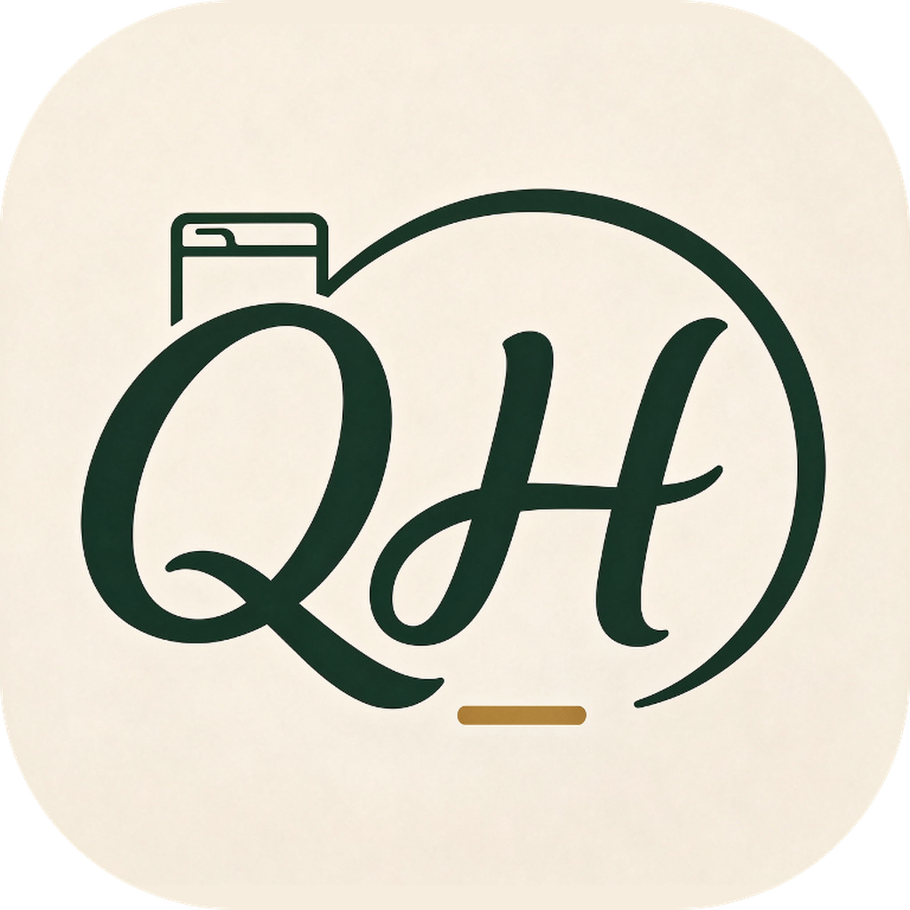

# 轻鸿 Qinghong

<p align="center">
  
</p>

一款为 HarmonyOS 打造的轻快好用浏览器，交互与功能设计参考 [Via 浏览器](https://viayoo.com/)。

## 功能特性

- **核心浏览**：多标签保活、无痕模式、会话恢复、阅读模式、网页翻译与语音朗读
- **隐私防护**：广告拦截订阅、智能防跟踪（ITP）、隐私报告
- **生态扩展**：Chrome 扩展兼容层（CRX3 安装 / 后台 / 消息 / 商店直装）、油猴用户脚本
- **数据管理**：书签、历史、下载、密码管理（HUKS 加密）、WebDAV 云同步
- **进阶能力**：DoH 加密解析、hosts、代理、UA 定制（大屏自动匹配 PC UA）、站点级设置、视频与图片独立播放、夜间模式、自定义字体与主页
- **开发者工具**：应用内 Chrome DevTools（C++ 调试桥 + 内置前端，支持停靠分栏）

## 技术栈

- **ArkTS / ArkUI**：Stage 模型，`compileSdkVersion 26`（HarmonyOS NEXT）
- **ArkWeb**：网页渲染与控制（请求拦截、广告过滤、调试协议）
- **C++ / NAPI**：DevTools 调试桥（`entry/src/main/cpp/`）
- **架构**：MVVM（ViewModel + @ObservedV2/@Trace 响应式状态）

## 项目结构

```
entry/src/main/
├── cpp/                  # NAPI 原生层（DevTools 调试桥）
├── ets/
│   ├── entryability/     # 应用入口与窗口/生命周期管理
│   ├── pages/            # @Entry 页面（Index 浏览器主壳）
│   ├── view/             # 管理页与设置页（书签/历史/下载/设置/关于等）
│   ├── components/       # 浏览器组件（TabWeb、工具栏、菜单、标签管理等）
│   ├── viewmodel/        # MVVM 层（标签/浏览/菜单/扩展/翻译等）
│   └── common/           # 常量、实体模型、工具类、数据库
└── resources/            # 资源（多语言字符串、图标、DevTools 前端）
```

## 构建与运行

1. 安装 [DevEco Studio](https://developer.huawei.com/consumer/cn/deveco-studio/)（含 HarmonyOS SDK，API 26）
2. 打开本项目，在 `File > Project Structure > Signing Configs` 配置签名
3. 连接 HarmonyOS 设备（开启开发者模式），点击 Run

命令行构建：

```bash
hvigorw assembleHap
```

## 说明

- 变更记录见 [CHANGELOG.md](CHANGELOG.md)
- 项目源自设计参考 Via 浏览器，应用本身为独立实现

## 开源许可

本项目以 [GPL-3.0](LICENSE) 许可证开源，欢迎提交 Issue 与 PR。
